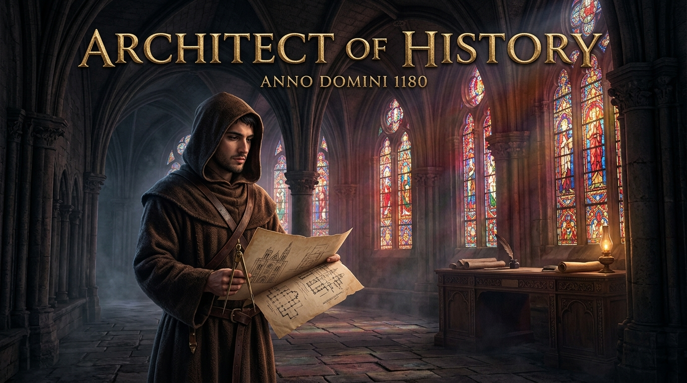

# 🏰 Архитектор Истории (Anno Domini 1180) — Product & Game UX Case Study

> **Как переосмыслить жанр исторического текстового квеста: мобильная эргономика, механика риторических стилей и эстетика ранней готики.**

---

### 📌 Карточка проекта
* **Роль:** Lead Product & Game UX Designer
* **Платформа:** Mobile-First Web / Progressive Web App (PWA)
* **Стек технологий:** Vanilla JavaScript (ES6+), HTML5 Semantic, CSS3 Custom Properties, Node.js
* **Статус:** [Запущен онлайн (Live Demo)](https://melok90.github.io/architect-history/)
* **Репозиторий:** [github.com/Melok90/architect-history](https://github.com/Melok90/architect-history)
* **Интерактивная страница кейса:** [Открыть case.html](https://melok90.github.io/architect-history/case.html)

---

## 1. Контекст и Продуктовый вызов

### Идея и сеттинг
Франция, лето 1180 года от Р.Х. Главный герой — молодой монах и зодчий **брат Лука**, ученик легендарного аббата Сугерия, строителя первой в мире готической базилики Сен-Дени. Лука владеет научно-инженерным багажом XXI века, но вынужден действовать в суровых реалиях средневековья под бдительным взором папской инквизиции.

### Главный парадокс прогрессорства
В XII веке невозможно объявить «это бактерии» или «давайте заменим романские полукруглые своды на стрельчатые арки с нервюрами, потому что они эффективнее распределяют нагрузку». За любое неосторожное слово героя объявят колдуном или еретиком.  
**Задача:** каждое передовое решение необходимо риторически легитимизировать через доступный средневековому человеку язык — Священное Писание, античные трактаты, крестьянский опыт или мистические откровения.

### Продуктовые боли целевой аудитории
1. **Проблема текстовых RPG:** Большинство нарративных игр либо представляют собой огромные простыни нечитаемого текста без визуальных ориентиров, либо скатываются в примитивный свайпер (как Reigns), теряя драматургию.
2. **Отсутствие мобильной адаптивности:** Сложные ролевые интерфейсы плохо адаптированы под экраны современных смартфонов (перекрываются вырезами камер, требуют мелких кликов, не дают тактильной обратной связи).
3. **Непрозрачность последствий:** Игрок часто не понимает, почему тот или иной вариант ответа привел к поражению, что вызывает фрустрацию.

---

## 2. UX-исследование и Бенчмаркинг

В ходе проектирования были детально проанализированы 3 ключевых продукта в жанре нарративного интерактива:

| Продукт | Ключевые преимущества | Ограничения для нашего сценария | Наше решение |
| :--- | :--- | :--- | :--- |
| **Reigns / Reigns: Her Majesty** | Молниеносный темп, баланс 4 параметров, удобство игры одной рукой. | Поверхностный сюжет, случайные смерти без драматургической глубины. | Сохранили 4 шкалы, но добавили скрытый счетчик риска и глубокий литературный нарратив. |
| **Pentiment** (Obsidian) | Шедевральная средневековая каллиграфия, историческая глубина, психологизм. | Исключительно десктоп/консоли, длинные 30-минутные сессии, высокий порог входа. | Внедрили книжную типографику (шрифт Spectral) и гравюрный стиль Дюрера для мобильного формата. |
| **Choice of Games** | Огромная вариативность, разветвленные сюжетные деревья. | Полное отсутствие визуала («книга в окне браузера»), нет динамики. | Создали уникальные ключевые арты к каждой локации и экран обратной связи «Эхо решения». |

---

## 3. Системный геймдизайн и Механика риторики

### Четыре шкалы благополучия
Игрок балансирует между четырьмя ресурсами обители:
1. **🌾 Процветание (Prosperity):** Здоровье монахов и крестьян, запасы зерна, сытость округи. Падение до нуля приводит к финалу «Разорённая обитель».
2. **⚙️ Прогресс (Progress):** Внедрение рациональных знаний XXI века (антисептика, трёхполье, своды, учёт). Требуется для открытия продвинутых решений в поздних главах.
3. **⛪ Церковь (Church):** Лояльность капитула монастыря, приора Гийома и парижского епископа. Падение до нуля вызывает «Отлучение от Церкви».
4. **💰 Казна (Treasury):** Финансовый ресурс на масштабные стройки. **Заблокирован на старте** и открывается только при получении сана «Советник».

### Уникальная механика: 4 Риторических Языка (Framing Languages)
Чтобы игрок понимал вектор влияния ответа без спойлеров, каждая реплика снабжена риторическим тегом:
* **`ВИДЕНИЕ` (Богословие Света):** Апелляция к мистическому озарению и идеям аббата Сугерия.  
  *Эффект:* Резкий рост шкалы **Церковь (+2)**, умеренный риск.
* **`АВТОРИТЕТ` (Каноны и Схоластика):** Ссылки на Аристотеля, Галена, устав святого Бенедикта.  
  *Эффект:* Рост **Церкви (+1)** и **Прогресса (+1)**, высокий авторитет среди духовенства.
* **`ОПЫТ` (Ремесло и Травы):** Крестьянская практика, народная медицина, чистка колодцев, севооборот.  
  *Эффект:* Максимальный рост **Процветания (+2)**, абсолютная безопасность **(Риск = 0)**.
* **`ПРЯМОТА` (Рационализм XXI века):** Сухой математический расчет, анатомия, вскрытие злоупотреблений.  
  *Эффект:* Взрывной **Прогресс (+2)** и **Влияние**, но удар по шкале **Церковь (-2)** и скачок **Риска инквизиции (+3..+4)**.

### Шкала Риска и Механика «Заметания следов» (Calm Streak)
Папский визитатор брат Раймунд внимательно следит за Лукой. Каждое дерзкое действие заполняет шкалу риска (0–15). При достижении 15 наступает поражение «Арест инквизицией».  
**UX-механика снятия стресса:** если игрок совершает 3 осторожных шага подряд («Опыт» или «Авторитет»), подозрение оседает: срабатывает триггер *«Инквизиция теряет след»*, и показатель риска автоматически снижается на 1 пункт.

---

## 4. UI Дизайн-система и Мобильное ремесло

### Цветовая палитра ранней готики
* **Charcoal Deep (`#080D0B`):** Основной фон, передающий полумрак собора и ночной кельи.
* **Monastery Surface (`#121C17`):** Тёмно-оливковое сукно бенедиктинских одеяний для карточек.
* **Suger's Gold (`#D3BC7E` / `#B79A56`):** Старое золото витражных окладов и церковной утвари.
* **Herbal Sage (`#A3BC94`):** Шалфей лазарета, обозначающий медицину и процветание.
* **Sealing Wax (`#C0736D`):** Сургуч папских булл, сигнализирующий об угрозе инквизиции.

### Типографика
* **Spectral (Serif):** Классическая гарнитура французской книжной традиции для заголовков, цитат летописи и реплик персонажей.
* **IBM Plex Sans (Sans-serif):** Высококонтрастный инженерный гротеск для численных шкал, бейджей, системных тегов и кнопок.

### Мобильная эргономика
1. **Зона большого пальца (Thumb-Zone):** Кнопки решений и нижняя навигация расположены в нижней половине экрана, обеспечивая комфортное управление одной рукой.
2. **Safe-Area Insets:** Верхний HUD и шторки адаптированы под вырезы Dynamic Island и «челки» iPhone (`padding-top: max(32px, env(safe-area-inset-top))`).
3. **Тактильный отклик (Haptic Feedback):** При выборе решения срабатывает микровибрация (`navigator.vibrate(12)`), а экран мягко растворяется (dissolve transition 160ms) перед показом дельт.

---

## 5. Результаты и Живое демо

* Разработан и развёрнут полноценный вертикальный срез игры из **5 глав** со случайными событиями («Вести из внешнего мира»), развилками и множественными финалами.
* Создана дизайн-система, объединяющая историческую атмосферу и современные стандарты мобильного веб-приложения.
* Проект опубликован в открытом доступе на GitHub Pages:

👉 **[Запустить игру «Архитектор Истории»](https://melok90.github.io/architect-history/)**  
👉 **[Открыть интерактивный кейс (case.html)](https://melok90.github.io/architect-history/case.html)**
