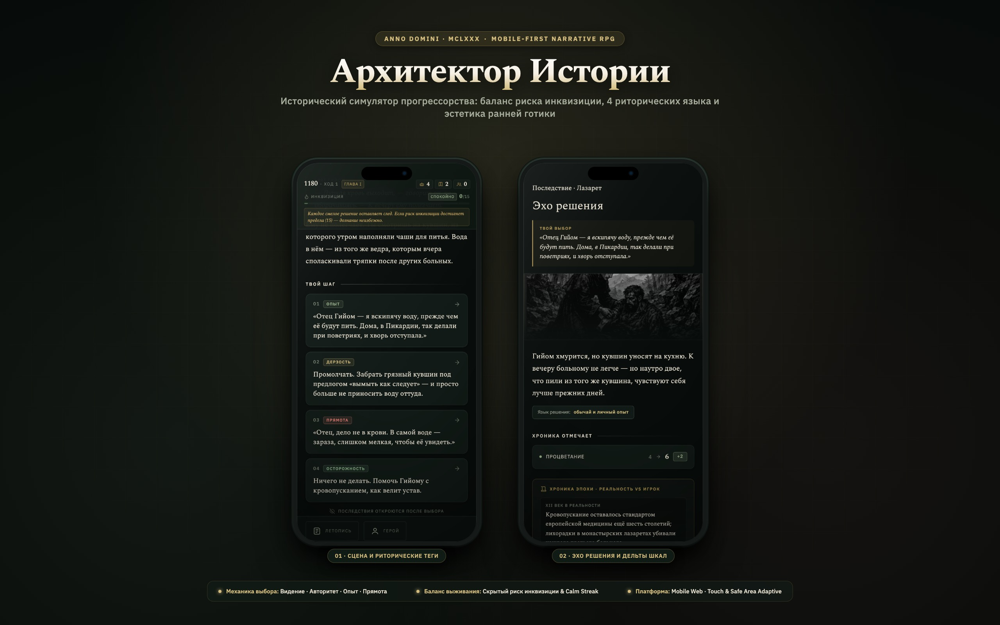
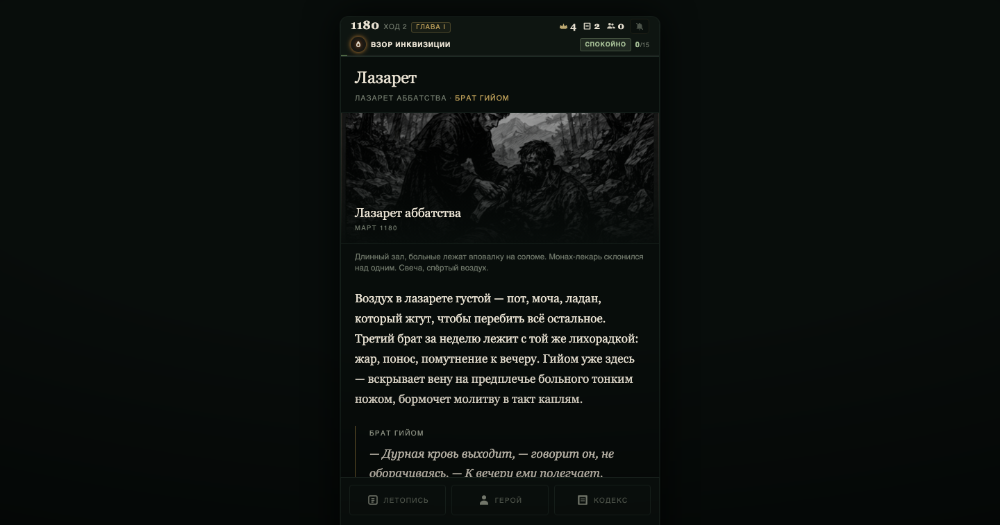
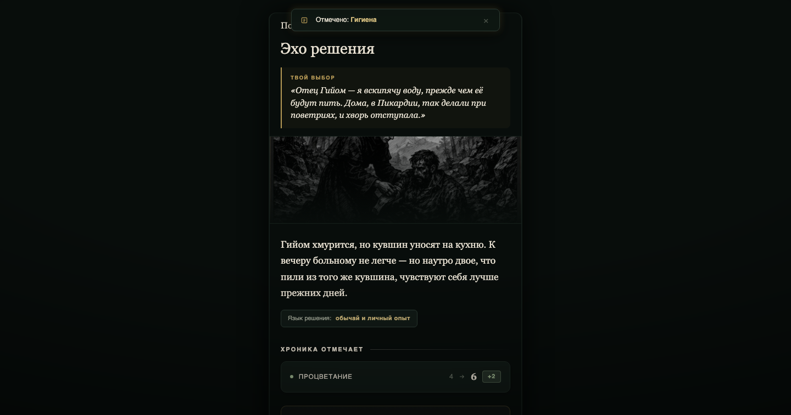
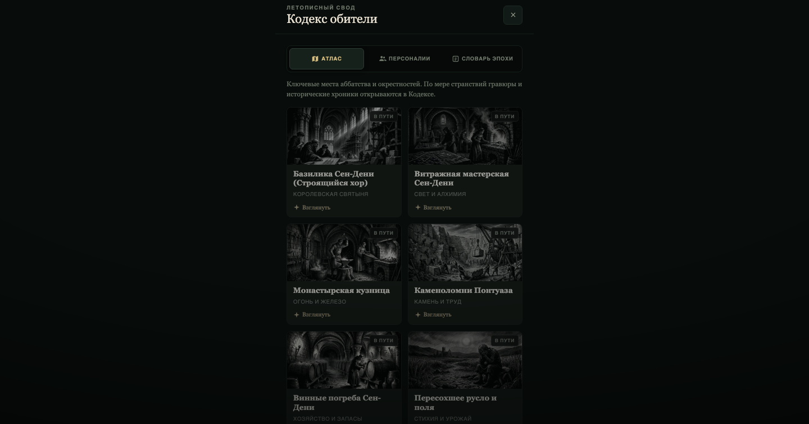
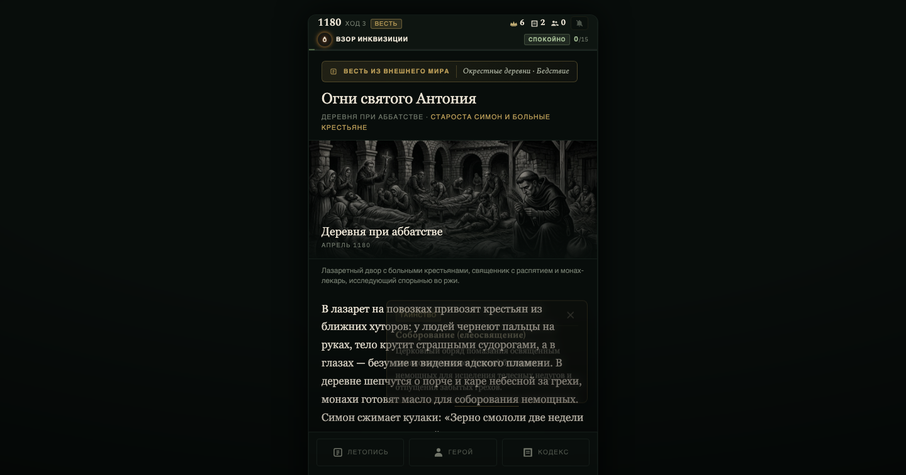
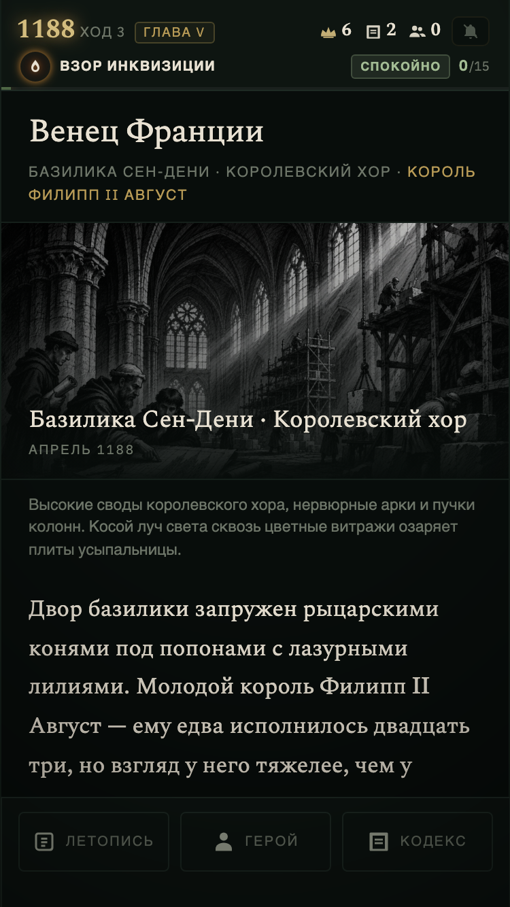

# 🏰 Архитектор Истории (Anno Domini 1180)

<p align="center">
  
</p>

<p align="center">
  <a href="https://github.com/Melok90/architect-history/releases/tag/v1.23.0"></a>
  <a href="#-тестирование-и-верификация-100-pass"></a>
  
  
  
</p>

> **Историческая нарративная RPG-новелла и симулятор прогрессорства о рождении готической архитектуры, медицине, науке и политике во Франции конца XII века.**

---

### 🎮 [ИГРАТЬ ОНЛАЙН В БРАУЗЕРЕ (GitHub Pages)](https://melok90.github.io/architect-history/)
### 📑 [СМОТРЕТЬ КЕЙС В ПОРТФОЛИО (Case Study)](https://melok90.github.io/architect-history/case.html)

**Прямые ссылки для запуска:**  
👉 **Игра:** [https://melok90.github.io/architect-history/](https://melok90.github.io/architect-history/)  
👉 **Кейс:** [https://melok90.github.io/architect-history/case.html](https://melok90.github.io/architect-history/case.html)  
👉 **История версий:** [CHANGELOG.md](CHANGELOG.md)

#### Мгновенный запуск со смартфона по QR-коду:
<p align="center">
  
  <br>
  <em>Наведите камеру смартфона для мгновенного перехода в игру</em>
</p>

---

## 📸 Скриншоты игрового процесса

<p align="center">
  
  
</p>
<p align="center">
  
  
</p>
<p align="center">
  
</p>

---

## 📖 Сюжет и исторический контекст

**Франция, лето 1180 года.** В Королевском аббатстве Сен-Дени разворачивается величайшая стройка эпохи — возведение нового хора и соборных сводов. Под началом настоятеля аббата Одона рождается новое искусство — ранняя французская готика, где камень устремляется ввысь, а цветной свет витражей воплощает присутствие Божественного.

Вы играете за **брата Луку** — монаха-учёного, хранящего память и знания грядущих веков. Ваша миссия — принести свет знания и технологий в тёмные века, балансируя между созиданием и опасностью обвинения в ереси:
* **Медицина против предрассудков:** спасти лазарет от чумной лихорадки и «огней святого Антония» с помощью гигиены, изоляции и дистилляции чистого спирта (*aqua ardens*).
* **Инженерия и гидротехника:** построить прочную плотину и передовое нижнебойное водяное колесо, преодолевая паводки и феодальные претензии сеньоров.
* **Камень и свет:** обуздать чудовищный распор соборных сводов с помощью нервюр, кованых связей и аркбутанов, создав рецепт кобальтового сапфирового стекла.
* **Взор Святой Палаты:** каждое дерзкое научное открытие привлекает внимание дознавателей инквизиции. Дойдёте ли вы до освящения собора или погибнете на костре?

---

## ✨ Ключевые возможности

### 🏛️ 1. Пять сюжетных глав и динамические события (1180–1194 гг.)
- **Глава I — Медицина:** лазарет Сен-Дени, чистая вода, карантин, спор с приором Гийомом.
- **Глава II — Сельское хозяйство:** трёхпольный севооборот, борьба с великой засухой 1181 года, защита амбаров.
- **Глава III — Экономика и учёт:** двойная бухгалтерия, Ландийская ярмарка, спасение вина через алембик.
- **Глава IV — Гидравлика и энергия:** плотина на реке, водяные мельницы, сукновальни и меха.
- **Глава V — Архитектура света:** каменоломни Понтуаза, битва циркулей, витражи, визит юного короля Филиппа II Августа и освящение хора.
- **Случайные и сезонные события (`RANDOM_EVENTS`):** королевские прево, фламандские купцы, беглые кузнецы, затмение солнца 1185 года, ночные бури и эрготизм.

### 🎨 2. Галерея ксилографических гравюр (32 уникальные иллюстрации)
Все сцены оформлены высокодетализированными гравюрами на дереве в строгом стиле Альбрехта Дюрера и средневековых манускриптов:
* **Базилика Сен-Дени** (`art_basilica.jpg`)
* **Витражная мастерская** (`art_glassworks.jpg`)
* **Портрет короля Филиппа II Августа** (`character_philip.jpg`)
* **Монастырская кузница** (`art_smithy.jpg`)
* **Каменоломни Понтуаза** (`art_quarry.jpg`)
* **Винные погреба** (`art_cellar.jpg`)
* **Великая засуха** (`art_drought.jpg`)
* **Лазарет в лютую зиму** (`art_winter.jpg`)
* **Весенний паводок («Талые воды»)** (`art_flood.jpg`)
* **Солнечное затмение 1185 года** (`art_eclipse.jpg`)
* **Ночная буря в обители** (`art_storm.jpg`)
* **Огни святого Антония (Эрготизм)** (`art_ergotism.jpg`)
* **Алембик из Монпелье** (`art_alembic.jpg`)
* *...и более 15 других сцен обители.*

### 📚 3. Интерактивный Кодекс и Глоссарий
- **Атлас обители (24 локации):** подробные исторические очерки об архитектуре, каменоломнях, медицине и богословии света.
- **Персоналии:** исторические досье ключевых деятелей эпохи.
- **Интерактивные микро-подсказки (Popover):** нажатие на термины в тексте сцен (*аркбутан, нервюра, алембик, спорынья, сервитут, хартия, денье*) мгновенно открывает пояснительную карточку с адаптивным позиционированием.

### 🔊 4. Процедурный саунд-движок (Web Audio API)
Аутентичный звуковой ландшафт без внешних mp3-файлов: шелест переворачиваемого пергамента, скрип гусиного пера, щебет птиц в клуатре и звон тяжелого монастырского колокола.

---

## 🛡️ Тестирование и верификация (100% PASS)

Проект сертифицирован комплексным автоматизированным тестовым набором в реальном браузере через Headless Chrome CDP:

| Этап | Инструмент | Описание | Результат |
|---|---|---|:---:|
| **1. Статический аудит** | `test_static_integrity.js` | 32 ассета, 23 термина глоссария, 24 локации, 0 diff между версиями | **PASSED** |
| **2. E2E Симуляция логики** | `test_logic_simulation.js` | Сквозное прохождение всех 5 глав, победа в финале, 3 аварийные концовки, 20 случайных событий | **PASSED** |
| **3. Интерфейс и адаптивность** | `test_browser_ui.js` | Навигация, тултипы, модалки Кодекса, 0 консольных ошибок, адаптивность (Desktop, Tablet, Mobile) | **PASSED** |
| **4. Персистентность (Save/Load)** | `test_persistence.js` | Запись в `localStorage`, восстановление после перезагрузки F5, сброс новой игры | **PASSED** |

---

## 💻 Архитектура и запуск

Проект спроектирован по принципу **Zero Dependencies / No-Build**:
- **Чистый стек:** Vanilla JavaScript (ES6+), семантический HTML5, адаптивный CSS3 с переменными палитры пергамента.
- **Полная автономность:** игра работает в любом современном браузере локально или через статический хостинг.

### Локальный запуск на компьютере:

```bash
# 1. Клонирование репозитория
git clone https://github.com/Melok90/architect-history.git
cd architect-history

# 2. Запуск любого локального сервера (или просто открыть index.html)
npx serve .
# либо: python3 -m http.server 3000
```
Откройте в браузере: `http://localhost:3000`

---

## 📜 Авторские права и лицензия (License & Copyright)

**Copyright © 2026 Melok ([@Melok90](https://github.com/Melok90)). Все права защищены.**

Все материалы проекта «Архитектор Истории», включая:
* Литературную часть (сценарий, сюжет, тексты глав, лор, биографии персонажей);
* Графику и визуальный стиль (ксилографические портреты, гравюры, авторские SVG-иконки, дизайн интерфейса);
* Программный код (архитектура, игровая логика, алгоритмы процедурного звука);
* Название и средства индивидуализации;

являются объектами интеллектуальной собственности и защищены законодательством об авторском праве.

Любое копирование, тиражирование, коммерческое использование или создание производных клонов без предварительного письменного согласия правообладателя **строго запрещено**. Полный текст лицензионных условий см. в файле [LICENSE](LICENSE).

По вопросам сотрудничества: [GitHub Profile (@Melok90)](https://github.com/Melok90)
